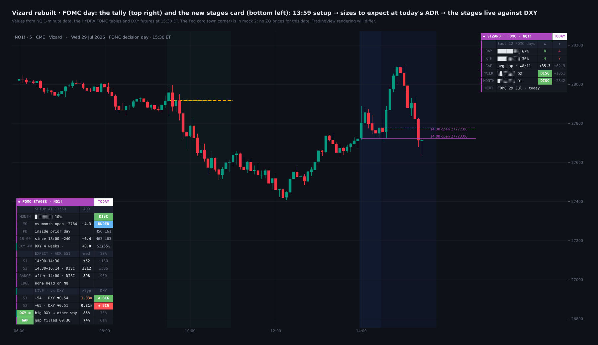
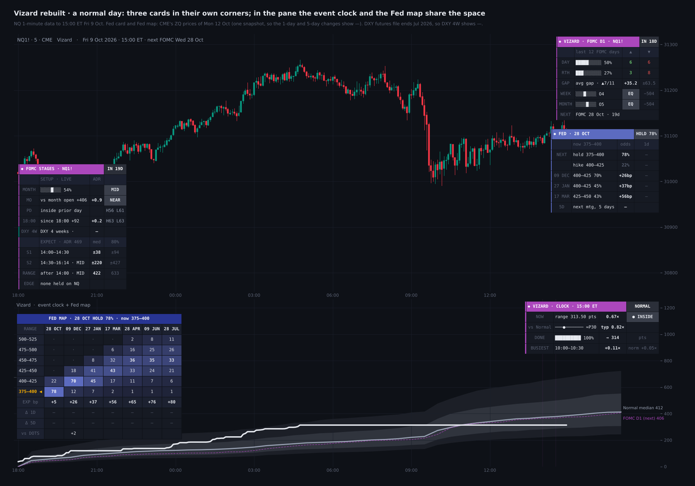
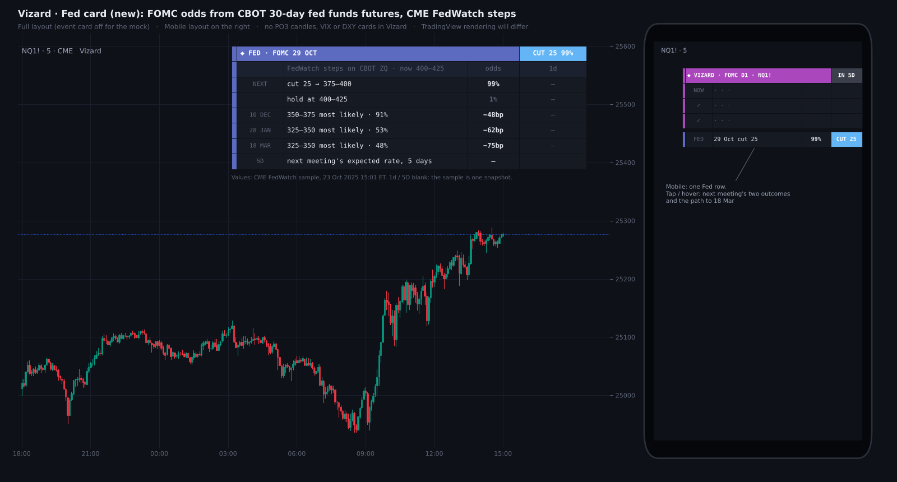
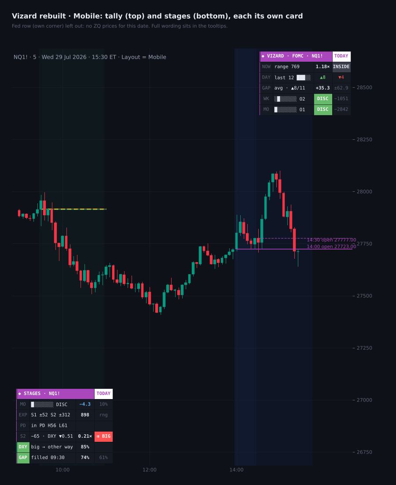

# Vizard

**FOMC Day Model for NQ & ES**

TradingView indicator, Pine Script v6. Open source under the Mozilla Public License 2.0.

*Mock-up of how it looks on the chart.*

**Vizard** maps FOMC decision days (statement 14:00 ET, press conference 14:30) on Nasdaq and S&P futures, and the meeting's first day before them. It covers four things:

- the structure the statement trades into;
- how far FOMC days with today's setup usually move, at today's ADR20;
- each stage live against the dollar;
- the Fed path the market prices, from fed funds futures.

Every ✓ row held in 2018–24 and again in 2025–26. *It is a map of how FOMC days usually behave, not a signal generator.*

## What it draws on price

- **Statement and press conference:** the 14:00–14:30 and 14:30–16:14 windows are shaded. The 14:00 and 14:30 opens extend right of price.
- **Snapshots:** fixed labels at 14:00 and 14:30 give price against the 09:30 open and the week's open, and stage 1's move.
- **Day 1:** the first meeting day's high and low are drawn live, then carried into the decision day.
- **RTH gap:** the prior 16:14 close, its 50% level, and the gap in eighths over NY AM on the FOMC day, with the quarter next to the open shaded.
- **Statement shock cone:** from the 14:00 open to 16:15, how far price had travelled by each 5 minutes on past FOMC days, up and down separately. It is scaled to today's ADR20. The inner band held half of FOMC days and the outer band 80%. Before 14:00 a faint preview sits at the current price.

## Stages card

Stage 1 is 14:00 → 14:30 (the statement). Stage 2 is 14:30 → 16:14 (the press conference to the RTH close). The card has three parts.

**SETUP** runs live until 13:59, then stays fixed for the rest of the day.

- Where price sits in the month's range so far: *premium* (top quarter), *middle* or *discount* (bottom quarter).
- Its distance from the month's open, in points and ADR: *over* or *under* means more than 1 ADR away.
- Its place against the prior day's high and low, and the move since 18:00. Each shows how often FOMC days in that spot made a new day high or low after 14:00. Above PDH, the day's low broke after 14:00 on only 28% of NQ FOMC days (29% on ES).
- DXY's last 4 weeks.

**EXPECT** gives how far FOMC days with that setup moved, as a median and 80th percentile in points at today's ADR20:

- stage 1, split by SEP meetings (the ones with new dots);
- stage 2;
- the range after 14:00.

A stretched month moved most: on NQ the range after 14:00 ran 1.38 ADR from a discount and 0.74 from a premium.

Results that held (**✓**) appear when today's setup matches. All of them are on ES:

- month premium: the 16:14 close finished above the 14:00 price on **65%** of FOMC days vs 36%;
- month discount: a new day low after 14:00 on all 7;
- over 1 ADR above the month's open: the range after 14:00 was **0.67** ADR vs 1.12;
- over 1 ADR below it: the next NY AM closed up **88%** vs 43% (8 days);
- SEP meetings: stage 1 was three times the size, **0.29** ADR vs 0.10.

On NQ no setup held in both periods, and the card says so.

**LIVE** shows each stage in points against its expected size, beside DXY's move in the same window, measured in DXY's own ADR20.

- Once DXY moves big (0.25 ADR in stage 1, 0.5 in stage 2), the index went the other way:
  - stage 1: **86%** of the time on NQ and **100%** on ES;
  - stage 2: **85%** on NQ and **93%** on ES.
  - With a smaller DXY move it was 57–73%.
- A big DXY move in the same direction as the index is the rare case, and is coloured red.
- *This confirms a stage, it does not call it:* DXY's first 10 minutes did not lead the rest of the stage, and stage 1 did not predict stage 2.
- The morning RTH gap traded back through the prior close by 16:14 on **74%** of NQ FOMC days vs 61% (ES 76% vs 60%).

The day after FOMC belongs to Hollow (Model 12), which reads it on its own card.

A broad search over everything knowable at 13:59 found no feature that called the direction after 14:00 out of sample. That is why the card sizes the day rather than picking a side.

## Fed card and Fed map

Seventeen monthly **CBOT 30-day fed funds futures** are read live and worked out with the same steps as CME Group's FedWatch Tool:

- each contract settles to 100 − the month's average effective rate;
- meetings are chained and combined as a probability tree.

Checked against CME's own page for 12 Oct 2026, every meeting was within 0.06 percentage points.

- **Fed card** (its own corner):
  - the next meeting's two outcomes and their odds;
  - the most likely target range for the three meetings after;
  - the change since yesterday's close.

  On a decision day after 14:00 it shows the surprise against the 13:59 pricing.

- **Fed map** (indicator pane, beside the clock): a heat table with one column per meeting and one row per 25bp target range. Each cell holds the odds, the most likely range is in bold and today's range is marked. Below it:
  - the expected change in bp;
  - its move over 1 day (since 13:59 after a decision) and over 5 days;
  - the market against the Fed's dot-plot median at each year's last meeting.

  The heat, header and marker colours are adjustable.

## Event clock and tally

- **Event clock (pane):** today's running range from 18:00 (or net move) is drawn against FOMC days, FOMC day 1 or normal days at the same time of day. It shows the median path with 25–75% and 10–90% bands, in half-hour steps scaled to today's ADR20. A NOW status reads *Above*, *Inside* or *Below* the middle half.
- **Tally card:**
  - the last N FOMC days' up and down closes (trading day and RTH) and their average RTH gap;
  - where price sits in this week's and this month's range by octant;
  - the next decision day.

  *The octant is a locator, not a tested signal.*

## Layouts

**View** sits at the top of the settings: Pane (clock + Fed map, either one, or cards only), Clock measure, Theme, Layout and Card text.

**Desktop** shows every row, and each card can sit in its own corner. **Mobile** folds each card for a phone:

- the tally with the clock in one NOW row;
- one Fed row;
- a seven-row stages card.

Full explanations stay in each cell's tooltip.

## How to use

- Built for **NQ / MNQ** and **ES / MES** (continuous or front month). On other symbols the cards say they show NQ figures.
- 1 to 15-minute charts suit the structure; the clock needs 60 minutes or lower.
- For a phone, use a separate chart layout with *Layout = Mobile*, since chart layouts sync across devices.
- After each Summary of Economic Projections (March, June, September, December), update the three dot-plot inputs.

## Data and method

- NQ and ES 1-minute data, Jan 2018 – Oct 2026 (ES to Aug 2026): 67 FOMC decision days each.
- Training period **2018–24**, test period **2025–26**. A row gets a ✓ only if it passed p < 0.05 over the full sample and sat on the same side in both periods. About 300 tests were run, so treat the ✓ rows as the steadiest descriptions, not proven edges.
- DXY rows: DXY futures, Feb 2023 – Jul 2026 (28 NQ and 29 ES FOMC days). On the chart they read TVC:DXY, which can be changed in the inputs.
- **ADR20** = mean (high − low) of the last 20 complete trading days.
- FOMC dates come from the Federal Reserve and are loaded to Dec 2027. Add new years in S_FOMC and raise LAST_DATE.
- No higher-timeframe value leaks future data. The month so far is built from completed daily bars plus the chart's own day; the weekly range is read only on the last bar.

## Limitations

*These are historical frequencies on 67 events: useful context, not guarantees.* Same-window DXY rows describe how a stage finishes and cannot be known in advance. TradingView delays CBOT data without a CBOT subscription; when ZQ contracts are missing or stale, the Fed card and map can differ from CME's page. Nothing here is financial advice.

## Credits

The Fed odds follow the method of CME Group's FedWatch Tool. Vizard is not affiliated with CME Group. ICT concepts (*Michael J. Huddleston*): premium and discount, the RTH gap and its 50% level. Written from scratch; open source under MPL 2.0.

## Add it to TradingView

1. In TradingView, open the **Pine Editor** (bottom panel).
2. Copy the contents of `Vizard.pine` into a new script.
3. **Save**, then **Add to chart**.

## More screenshots

## License

Mozilla Public License 2.0, see [LICENSE](LICENSE). © Unclehk2000.

*Historical frequencies, not guarantees. Nothing here is financial advice.*
